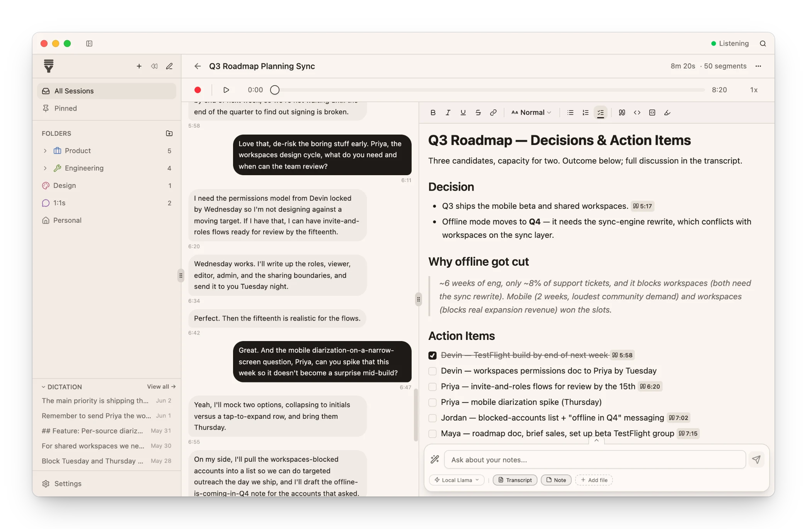
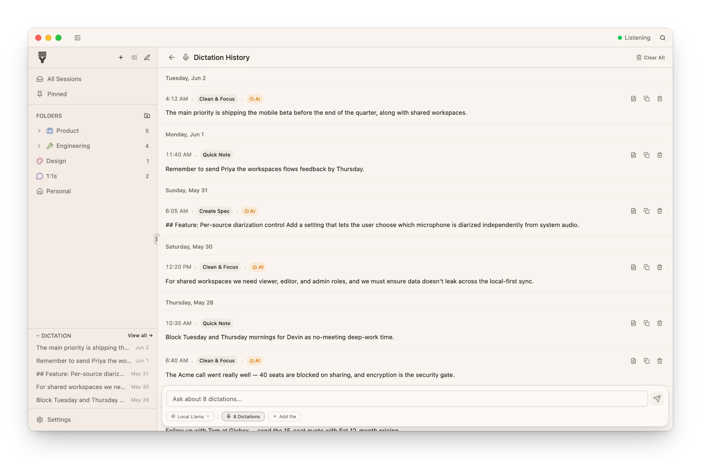
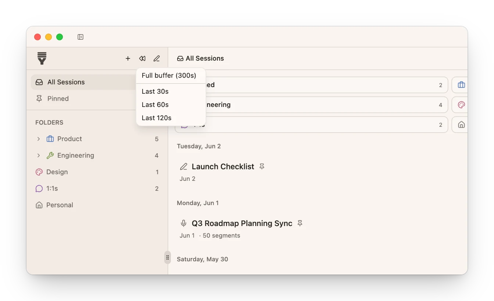
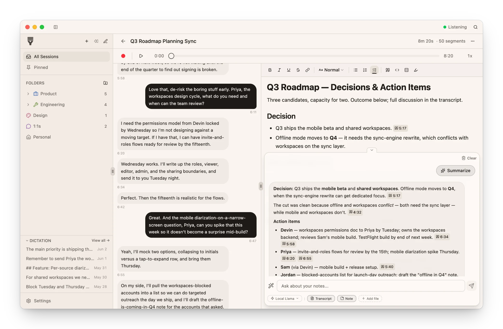
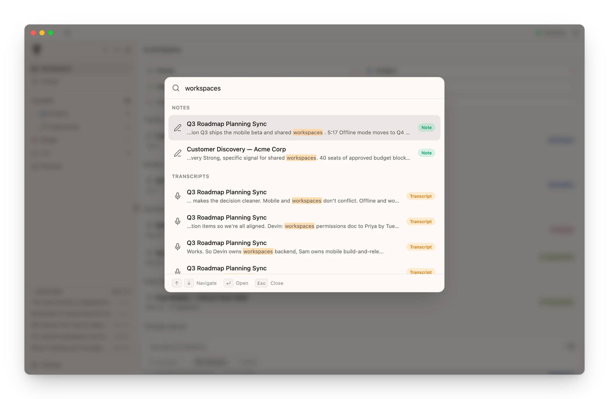

  

<h1 align="center">YapStack</h1>

  <strong>Private, open-source AI meeting notes, transcription, and voice dictation for Mac and Windows.</strong> 
  Record any call or conversation and turn it into searchable notes, or type with your voice in any app. 
  Speech-to-text runs offline, on your own device. No meeting bots, no account required.

  <a href="https://github.com/hookr-dev/YapStack/releases"><strong>⬇️ Download for macOS &amp; Windows</strong></a> 
  Free · open source · <a href="#install">install guide</a>

  <a href="https://yapstack.app">Website</a> ·
  <a href="#forgot-to-hit-record-rewind-and-keep-it">Rewind</a> ·
  <a href="#offline-voice-dictation-and-voice-typing-in-any-app">Dictation</a> ·
  <a href="#what-leaves-your-machine">Privacy</a> ·
  <a href="#frequently-asked-questions">FAQ</a> ·
  <a href="docs/INDEX.md">Docs</a>

  
  
  
  

  <picture>
    <source media="(prefers-color-scheme: dark)" srcset="docs/screenshots/session-dark.webp" />
    
  </picture>

> [!WARNING]
> **YapStack is in alpha.** Read the [`CHANGELOG`](CHANGELOG.md) before upgrading, because data formats may still change between releases.

## Why YapStack?

YapStack is a desktop app for **meeting transcription, AI note-taking, and voice dictation** that runs entirely on your own Mac or Windows PC. Use it to capture your microphone and system audio, which covers Zoom, Google Meet, Microsoft Teams, Slack huddles, or anything else that plays sound. You can also use it to dictate into any app with a keyboard shortcut. Speech recognition happens locally, and your transcripts, audio, and notes stay together on your disk.

- 🔒 **Private by design.** Audio and transcripts are processed and stored on your machine, and the app works offline.
- 🤖 **No bots in your meetings.** Nothing joins the call; YapStack listens to your own audio devices.
- ⏪ **Forgot to hit record? Rewind.** YapStack keeps the last few minutes of audio in memory, so you can start a recording *after* the important part began and still keep it, audio and transcript included.
- 🎙️ **Dictation that types for you.** Hold a shortcut, talk, let go, and the text appears in whatever app you're using.
- 🧠 **Bring your own AI, or none.** It works with OpenAI, OpenRouter, or any OpenAI-compatible endpoint, including fully local models through Ollama, LM Studio, or llama.cpp. Every AI feature is optional.
- 🆓 **Free and open source.** AGPL-3.0, with no feature paywalls.

## Install

1. Download the latest build from [**GitHub Releases**](https://github.com/hookr-dev/YapStack/releases):
   - **macOS:** `.dmg` (macOS 13 Ventura or later, Apple Silicon recommended). Recording system audio from calls needs macOS 14.2 or later.
   - **Windows (x64):** `-setup.exe`
2. Open YapStack and follow the setup. It downloads the speech-recognition model the first time it runs.
3. Grant microphone access. On macOS, also grant screen-recording permission, which macOS requires for capturing system audio.

**Building from source:** `pnpm install && pnpm dev` (this builds the required transcription sidecars first). See [`docs/DEVELOPMENT.md`](docs/DEVELOPMENT.md) for prerequisites; `pnpm check` runs the full test gate.

## Screenshots

<table>
  <tr>
    <td width="50%" valign="top">
      <strong>Dictate into any app</strong> 
      Every dictation is kept in a searchable history, with optional AI cleanup presets.  
      <picture>
        <source media="(prefers-color-scheme: dark)" srcset="docs/screenshots/dictation-dark.webp" />
        
      </picture>
    </td>
    <td width="50%" valign="top">
      <strong>Rewind to what you missed</strong> 
      Start a recording from the last 30 seconds, a few minutes, or the whole buffer.  
      <picture>
        <source media="(prefers-color-scheme: dark)" srcset="docs/screenshots/rewind-dark.webp" />
        
      </picture>
    </td>
  </tr>
  <tr>
    <td width="50%" valign="top">
      <strong>Chat with your meetings</strong> 
      Ask questions and get summaries and action items, with clickable citations back to the transcript.  
      <picture>
        <source media="(prefers-color-scheme: dark)" srcset="docs/screenshots/ai-chat-dark.webp" />
        
      </picture>
    </td>
    <td width="50%" valign="top">
      <strong>Find anything instantly</strong> 
      Press ⌘K to search every transcript, note, and session title at once.  
      <picture>
        <source media="(prefers-color-scheme: dark)" srcset="docs/screenshots/search-dark.webp" />
        
      </picture>
    </td>
  </tr>
</table>

Screenshots use a fictional demo workspace.

## Forgot to hit record? Rewind and keep it

The best part of a conversation is usually the part you didn't think to record. While YapStack is capturing, it keeps a rolling buffer of your mic and system audio **in memory**. Buffered audio that never becomes part of a recording or dictation is simply discarded; it is never written to disk.

When you realize something worth keeping just happened, hit **Rewind** (⌘⌥R, or Ctrl+Alt+R on Windows), or pick how far back to go: the last 30 seconds, a couple of minutes, or the whole buffer. YapStack starts a session *from that point in the past*:

- **The audio is saved** into the recording, so you can replay exactly what was said.
- **The missed stretch is transcribed** in the background while live transcription carries on, so the session catches up without interrupting you.
- **You choose how far back it reaches:** 1, 2, 5 (the default), or 10 minutes, in Settings → Audio.

## Offline voice dictation and voice typing in any app

YapStack doubles as a **system-wide voice typing** tool. Hold a shortcut, speak, release, and the text lands wherever your cursor is: email, Slack, your code editor, a doc. Speech recognition runs on your device, so dictation works offline too.

- **Several dictation slots, each with its own shortcut.** It ships with *Raw Dictation* (⌃⇧D) for exactly what you said, plus two AI cleanup presets: *Clean & Focus* (⌃⇧C), which strips filler and false starts, and *Engineer* (⌃⇧X), which is tuned for technical writing. Assign an AI model to a slot to turn its cleanup on, or write your own prompts.
- **Hold to talk, or tap to toggle,** whichever suits you.
- **Paste it, copy it, or save it as a note.**
- **Searchable history:** completed dictations are saved so you can replay, copy, or turn them into notes later.

AI cleanup is optional. Without it, you still get fast, accurate on-device dictation.

## Features

### Capture and transcribe
- **Mic and system audio**, recorded separately, so your words and the other participants are labeled apart.
- **On-device speech-to-text:** NVIDIA Parakeet TDT v3 (fast and accurate for English plus 24 European languages) or OpenAI Whisper (99 languages).
- **[Rewind](#forgot-to-hit-record-rewind-and-keep-it)** a recording from up to 10 minutes in the past.
- **Speaker diarization (optional)** with renameable speakers, using Sortformer with Parakeet.
- **Full audio playback** at 0.5×–2×; click any timestamp to jump straight to that moment.

### Notes and AI
- **Rich-text notes** in a split pane beside the transcript, with version history and restore.
- **AI session chat** that summarizes, pulls out action items, and can rename, tag, file, and save notes for you, with undo for each action and citations back to the transcript.
- **[Voice dictation](#offline-voice-dictation-and-voice-typing-in-any-app)** into any app, with optional AI cleanup.
- **Local LLM support:** point YapStack at [Ollama, LM Studio, or llama.cpp](docs/LOCAL_LLM.md) and no text leaves your machine.

### Organize and find
- Nested **folders**, **tags**, **pinning**, and drag-and-drop.
- **⌘K full-text search** across sessions, notes, and transcript segments.
- **Export** transcripts to Markdown or plain text.

### Desktop-native
- Menu bar / system tray app with customizable global shortcuts, a recording indicator, and close-to-minimize.
- Built with Rust and Tauri for a native, lightweight app on macOS and Windows.

## Platform support

| Platform | Status | Notes |
|---|---|---|
| macOS (Apple Silicon) | ✅ Supported | Primary target. Metal Whisper; Parakeet on WebGPU with the int8 model. |
| macOS (Intel) | ⚠️ Best-effort | Builds and runs; reduced performance, limited testing. |
| Windows (x64) | ✅ Supported | Installers ship with each release. Parakeet uses WebGPU and falls back to CPU (force CPU with `YAPSTACK_PARAKEET_ACCEL=cpu`); Whisper runs on CPU. See [ADR 0004](docs/adr/0004-cross-platform-rollout-windows-first.md). |
| Linux | ❌ Not yet | No current build target. |

## What leaves your machine

Here is the complete list:

| When | What goes where |
|---|---|
| **Normal use** | Your audio, transcripts, and notes never leave your machine. Official builds send anonymous usage analytics via [Aptabase](https://aptabase.com): which features are used, counts and durations, short error messages, app version, OS, and locale. Analytics never include audio, transcripts, notes, or text you write. You can turn them off in Settings → General, and builds compiled without the analytics key send none. The app also checks for updates and downloads speech models from Hugging Face on first use. |
| **AI features (optional)** | If you connect a cloud AI provider, the text you send it goes to that provider. Use a [local model](docs/LOCAL_LLM.md) and nothing leaves. |
| **Sync (optional, off by default)** | Encrypted changes and encrypted audio go to the relay **you** run. See below for exactly what it can and cannot see. |

## Sync across devices (optional, self-hosted)

Sync is **off by default**. When you turn it on, your devices sync through a small relay you host yourself: a Docker stack with the server, Postgres, and MinIO. Your content is end-to-end encrypted (XChaCha20-Poly1305) on your device before upload. The design assumes the relay is hostile, and it still can't read your content.

| Question | Answer |
|---|---|
| **What does the relay never see?** | Your transcripts, notes, titles, audio, AI prompts, your password, or any unwrapped key. An integration test scans every column of the relay database for a plaintext canary. |
| **What does the relay see?** | Account and device metadata: your account email, device count and names, your IP, and the number, size, and timing of encrypted blobs. |
| **What can a hostile relay do?** | Withhold, delay, or delete your encrypted data. It cannot decrypt it, forge a device approval, or silently alter content: tampered data fails authentication and is quarantined. Known limitations are documented in the [crypto spec](docs/CRYPTO_SPEC.md). |

New devices are approved from a device you already trust by comparing a security code on both screens. A **recovery code** gets you back in if you forget your password. If you lose both the password and the recovery code, your synced data is unrecoverable. That is by design: there is no server-side reset.

> [!NOTE]
> Sync ships in releases built from the current `main`. Releases up to and including `v1.0.0-alpha.12` were built without it; to use sync before the next release, build from source with `--features sync`.

To run a relay, see [`docs/self-hosting.md`](docs/self-hosting.md). The full cryptographic design is in [`docs/CRYPTO_SPEC.md`](docs/CRYPTO_SPEC.md).

## Frequently asked questions

<strong>Is YapStack free?</strong>

Yes. YapStack is free and open source under AGPL-3.0, and no feature is held back from the open-source build. Self-hosted sync is unlimited. See [our open-source promise](#our-open-source-promise).

<strong>Does it work offline?</strong>

Yes. Recording, transcription, dictation, notes, and search all run locally. You only need a connection to download a speech model the first time, and optionally for cloud AI or sync.

<strong>Does a bot join my Zoom, Google Meet, or Teams calls?</strong>

No. YapStack records your microphone and your computer's system audio directly, so it works with any meeting app (or none) without adding a participant to the call.

<strong>What if I forget to press record?</strong>

Hit Rewind. While capturing, YapStack keeps the last few minutes of audio in memory (5 minutes by default, up to 10). Rewinding starts a session from that point in the past, saves the audio, and transcribes it. See [Rewind](#forgot-to-hit-record-rewind-and-keep-it).

<strong>Can I use YapStack just for dictation or voice typing?</strong>

Yes. Global shortcuts let you dictate into any app on your computer, with optional AI cleanup, and you never have to open a meeting session. See [Dictation](#offline-voice-dictation-and-voice-typing-in-any-app).

<strong>How does it compare to Superwhisper, Wispr Flow, or MacWhisper?</strong>

YapStack is a free, open-source option for voice dictation. Speech-to-text runs on your device with Parakeet or Whisper, it works on both macOS and Windows, and the same app also records and transcribes your meetings. AI cleanup is optional and can use a local model.

<strong>Is YapStack an open-source alternative to Otter.ai or Granola?</strong>

It covers similar ground (meeting transcripts, AI summaries, and action items) with a different model. Transcription happens on your hardware, your library lives on your disk, and there's no vendor account in the loop. Because it's open source, you can audit exactly what it does. If you want your notes on more than one device, you run the sync server yourself, and your content stays end-to-end encrypted.

<strong>Which languages are supported?</strong>

Parakeet TDT v3 (the default) supports English and 24 other European languages. Whisper supports 99 languages. You can switch engines in Settings → Transcription.

<strong>Can I use it with a local LLM instead of ChatGPT?</strong>

Yes. Any OpenAI-compatible endpoint works, including Ollama, LM Studio, and llama.cpp. See [`docs/LOCAL_LLM.md`](docs/LOCAL_LLM.md). Transcription never needs an AI provider at all.

<strong>Do I need to run a server?</strong>

No. A server is only needed if you want multi-device sync. On a single computer, YapStack is fully self-contained.

## Our open-source promise

[`LICENSING.md`](LICENSING.md) is a durable covenant about how the commercial side will and won't work:

- **AGPL-3.0-only, DCO, no CLA.** We never collect relicensing rights, so the project *cannot* be switched to a proprietary license.
- **Limits, never features.** Any hosted tier may differ only in quantitative limits; no feature is ever withheld from the open-source build.
- **Self-hosting is the top tier, forever.** A self-hosted relay defaults to unlimited everything.
- **Zero phone-home.** The relay's only outbound calls go to the storage and database *you* configure, and it cannot be remotely disabled.

The YapStack name and marks are covered separately by [`TRADEMARK.md`](TRADEMARK.md).

## Contributing

PRs are welcome. Start with [`CONTRIBUTING.md`](CONTRIBUTING.md), [`docs/PRINCIPLES.md`](docs/PRINCIPLES.md), and [`docs/DEVELOPMENT.md`](docs/DEVELOPMENT.md). Contributions are accepted under the [DCO](DCO), and the full gate is `pnpm check`. This project follows the [Contributor Covenant](CODE_OF_CONDUCT.md). Report security issues per [`SECURITY.md`](SECURITY.md), not as public issues.

YapStack is built with AI pair-programming as a first-class part of the workflow. Use whatever tools you like: we care about correctness, design clarity, and tests, not provenance.

## Architecture

Tauri v2 (Rust backend, React 19 frontend), with nine workspace crates spanning audio capture, on-device transcription, the E2E crypto layer, the sync engine, and the self-hostable relay server. Start at [`docs/ARCHITECTURE.md`](docs/ARCHITECTURE.md); the full documentation map is [`docs/INDEX.md`](docs/INDEX.md).

## License

[AGPL-3.0-only](LICENSE). You can use, modify, and redistribute YapStack freely. If you run a modified YapStack as a network service, you must share your modifications under the same license. Name and marks: [`TRADEMARK.md`](TRADEMARK.md).
